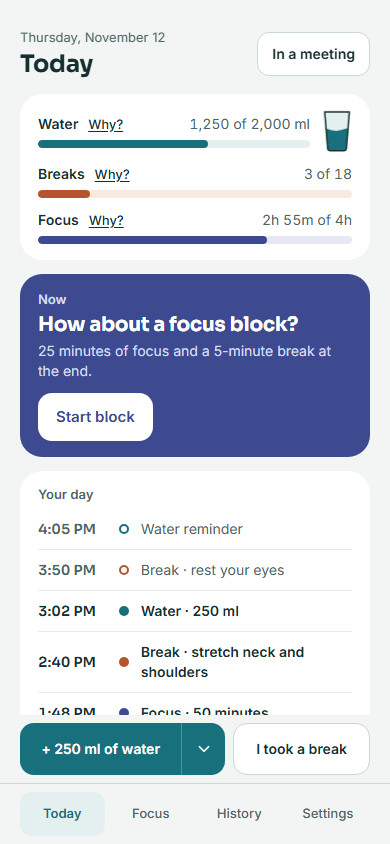
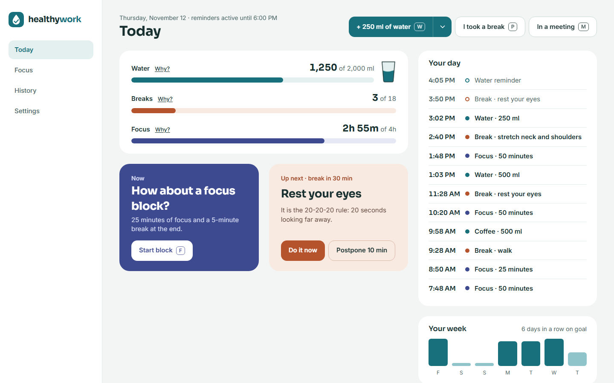
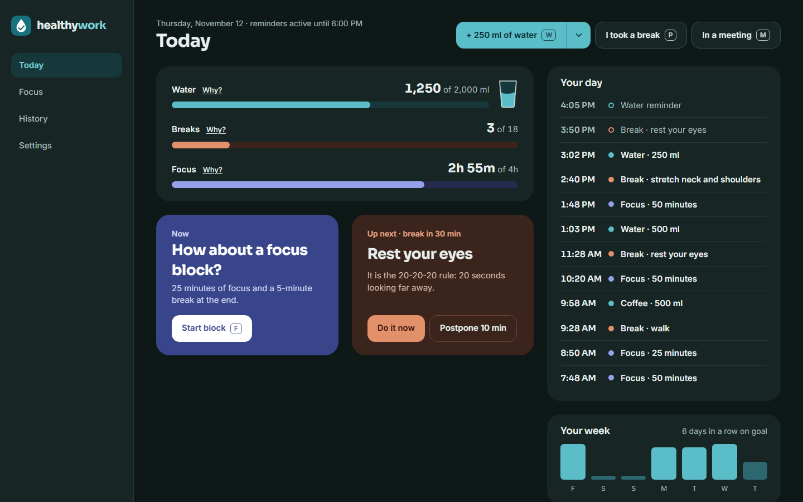
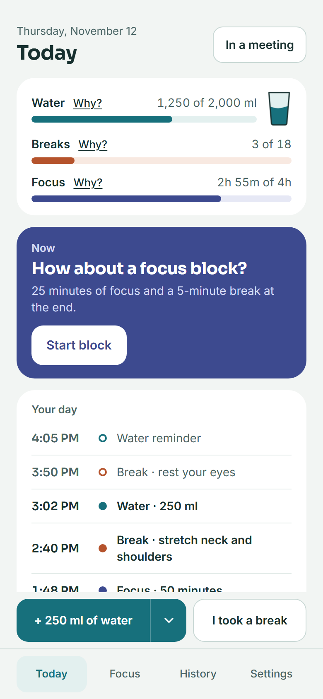
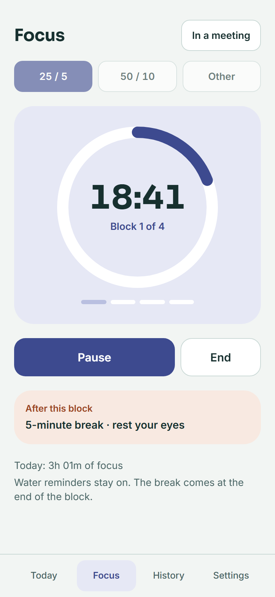
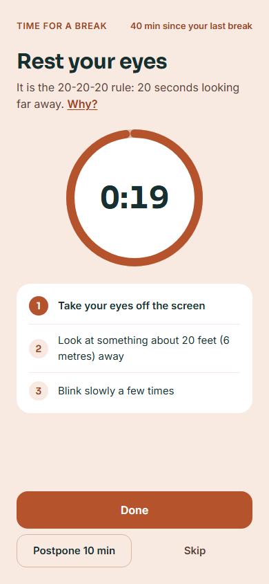
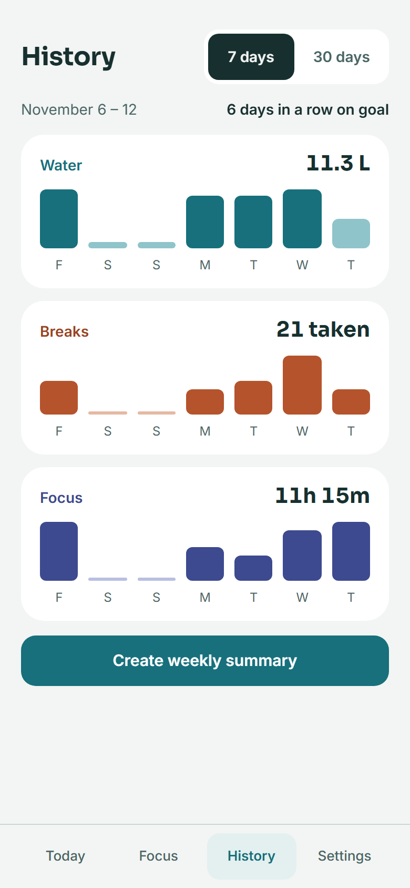

<p align="center">
  
</p>

<h1 align="center">HealthyWork</h1>

<p align="center">
  Water, movement breaks and focus blocks for people who work at a computer.<br>
  Free, open source, and your data never leaves your device.
</p>

<p align="center">
  <a href="https://yagopereiradev.github.io/healthywork/">
    
  </a>
</p>

<p align="center">
  English · <a href="README.pt-BR.md">Português</a>
</p>

<p align="center">
  
</p>

HealthyWork is a small app that stays open while you work and looks after the basics: it reminds you to drink water, to get up and move, and helps you work in focus blocks with a break at the end of each one. It opens in the browser, installs like an app on Mac and Windows, and works offline.

There is no account, no server and nothing to configure. [Try it with sample data.](https://yagopereiradev.github.io/healthywork/?demo=1)

|                           Light                           |                          Dark                           |
| :-------------------------------------------------------: | :-----------------------------------------------------: |
|  |  |

<p align="center">
  
  
  
  
</p>

## What it does

- **Water.** A daily goal you choose, one tap to log 250 ml, and any other amount or drink (coffee and tea count). Reminders stop for the day once you reach the goal.
- **Movement breaks.** A gentle full-screen reminder with one simple thing to do: walk, stretch your neck and shoulders, rest your eyes, loosen your wrists or stretch your back. One tap to confirm, and you can always postpone or skip.
- **Focus blocks.** 25/5, 50/10 or your own lengths, in cycles of four. When a block ends, the break opens by itself.
- **In a meeting.** Silence everything for 30 minutes, an hour, or until you are back. Reminders return on their own.
- **Your day and your history.** A timeline of today, and the last 7 or 30 days for water, breaks and focus.
- **Weekly summary.** A shareable image with your numbers for the week, made on your device.
- **Yours to shape.** Working hours and days, reminder pace, light and dark themes, English, Portuguese and Spanish, keyboard shortcuts (<kbd>W</kbd> water, <kbd>P</kbd> break, <kbd>F</kbd> focus, <kbd>M</kbd> meeting, <kbd>?</kbd> for the list).

Reminders work while HealthyWork is open, including minimized or installed as an app. With the app closed, they do not arrive.

## Built on evidence

Every health feature points to a source, and the app does not promise more than the study showed. Each bar has a "Why?" that says what was found, where the study stops, and links to the original.

| In the app                     | What the source says                                                                                                       | Where it stops                                                 |
| ------------------------------ | -------------------------------------------------------------------------------------------------------------------------- | -------------------------------------------------------------- |
| A 2,000 ml goal you can change | The "8 glasses a day" rule has no scientific basis. EFSA considers 2.0 L a day adequate for women and 2.5 L for men.       | Reference values for a population, not a prescription for you. |
| 5 minutes of walking every 30  | The only pattern tested that lowered both blood sugar and blood pressure over 8 hours of sitting. Tiredness went down too. | 11 participants, in a laboratory.                              |
| Short breaks                   | Breaks of up to 10 minutes increase energy and reduce tiredness.                                                           | No significant effect on performance.                          |
| The 20-20-20 eye break         | Two weeks of reminders reduced symptoms of eye strain and dry eye.                                                         | 29 participants. The effect was gone a week after stopping.    |
| Focus blocks with a set break  | Students with scheduled breaks reported less tiredness and distraction than those who stopped whenever they felt like it.  | 87 students. Both groups completed the same amount of work.    |
| Reminders on the computer      | They help reduce sitting time a little.                                                                                    | The effect is small and was not statistically significant.     |

The full notes, with every link and the product decision that came out of each source, are in [docs/EVIDENCE.md](docs/EVIDENCE.md).

So HealthyWork says "less tiredness" and "more energy". It does not say it will make you get more done, and it makes no medical claims.

## Install it as an app

Installed, HealthyWork gets its own window and icon, and keeps reminding you while minimized.

**Windows and Mac, with Chrome or Edge:** open [HealthyWork](https://yagopereiradev.github.io/healthywork/), then click **Install app** in the sidebar, or the install icon at the right end of the address bar.

**Mac, with Safari:** open [HealthyWork](https://yagopereiradev.github.io/healthywork/), then choose **File > Add to Dock**.

**iPhone and iPad:** tap **Share**, then **Add to Home Screen**.

## Privacy

Your data never leaves your device.

- Everything is stored in your browser (IndexedDB). There is no server, no account, no analytics and no tracking.
- The fonts ship with the app, so not even a font request goes out.
- The weekly summary image is drawn on your device.
- You can export everything to a file, import it on another device, or erase it all, in Settings.

Because the data lives in your browser, clearing the browser's site data erases it. Export a backup now and then if your history matters to you.

## Run it locally

```bash
git clone https://github.com/yagopereiradev/healthywork.git && cd healthywork
npm install
npm run dev
```

That is all: no `.env`, no keys, no backend. Open http://localhost:5173, or http://localhost:5173/?demo=1 for sample data.

| Command             | What it does                                       |
| ------------------- | -------------------------------------------------- |
| `npm run dev`       | Start the app                                      |
| `npm test`          | Unit and component tests (Vitest)                  |
| `npm run e2e`       | End-to-end tests (Playwright)                      |
| `npm run lint`      | ESLint                                             |
| `npm run typecheck` | TypeScript                                         |
| `npm run build`     | Production build with the service worker           |
| `npm run media`     | Recapture the screenshots and the GIF in this file |

Built with Vite, React, TypeScript, Tailwind CSS, Motion, Dexie, i18next and Workbox.

## Roadmap

HealthyWork is deliberately small. These are ideas, not promises, and none of them will ever require an account to use what exists today:

- Optional sync between your own devices
- Calendar integration, so "In a meeting" turns on by itself
- A desktop installer (Tauri)
- Friendly challenges between colleagues
- Posture hints from the webcam, processed on the device
- Suggestions that adapt to how your day is going

Data access already sits behind one interface (`src/data/store.ts`), so sync can arrive without touching a single screen.

## Contributing

Bug reports, translations and pull requests are welcome. Start with [CONTRIBUTING.md](CONTRIBUTING.md), and look for issues labelled [good first issue](https://github.com/yagopereiradev/healthywork/labels/good%20first%20issue).

One rule is particular to this project: a new health claim needs a source, discussed in an issue first.

## Health notice

HealthyWork does not replace medical advice. Goals are suggestions and you can adjust every one of them. If you have a fluid restriction or a health condition, follow what your doctor tells you.

## License

[MIT](LICENSE)
