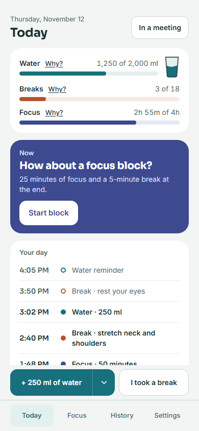
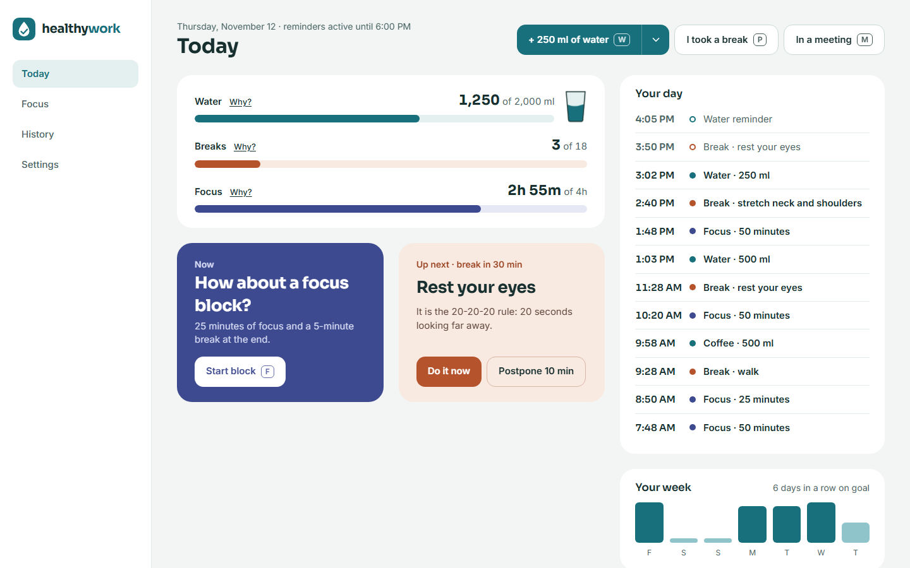
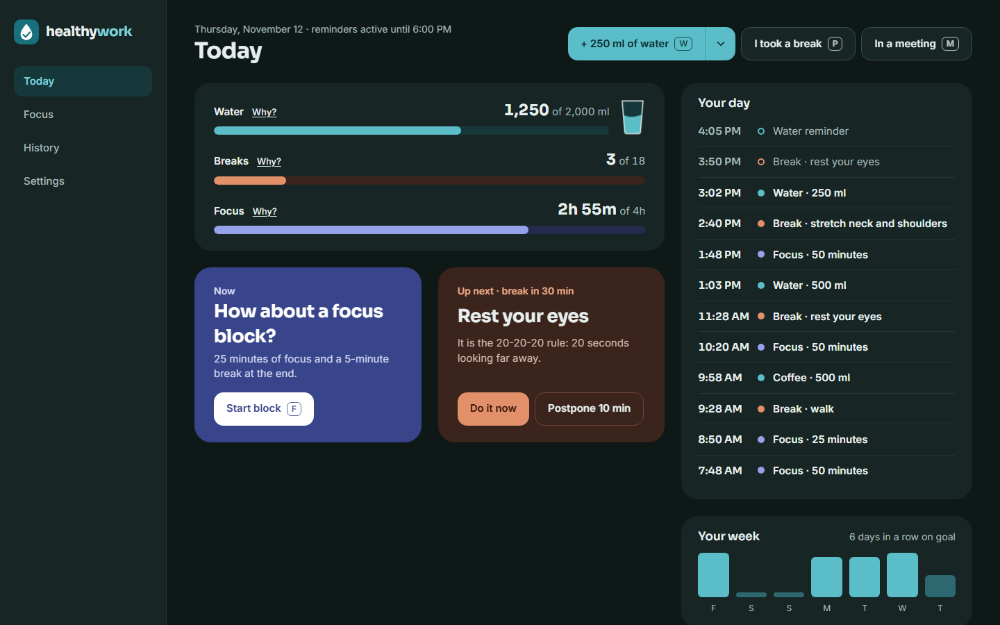
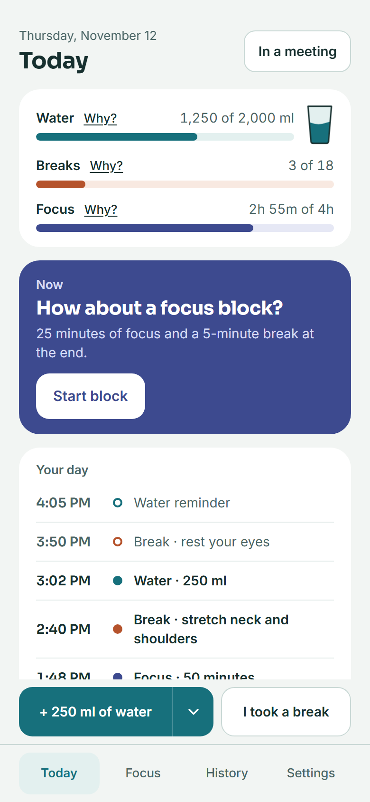
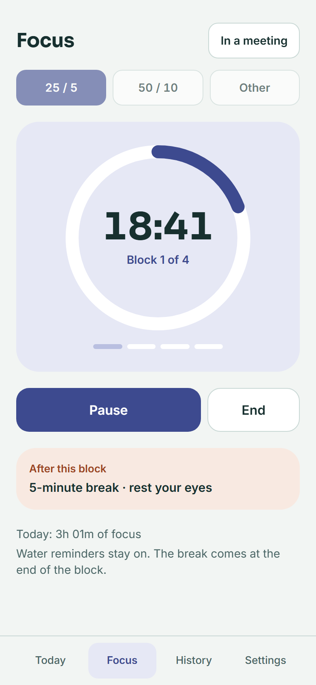
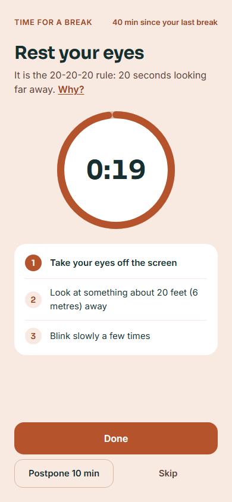
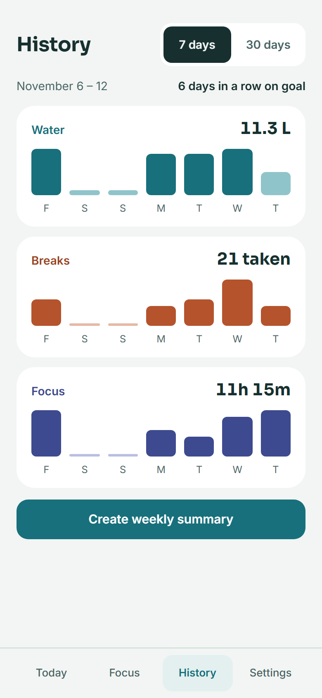

<p align="center">
  
</p>

<h1 align="center">HealthyWork</h1>

<p align="center">
  Água, pausas para se mexer e blocos de foco para quem trabalha no computador.<br>
  Gratuito, open source, e seus dados nunca saem do seu dispositivo.
</p>

<p align="center">
  <a href="https://yagopereiradev.github.io/healthywork/">
    
  </a>
</p>

<p align="center">
  <a href="README.md">English</a> · Português
</p>

<p align="center">
  
</p>

O HealthyWork é um app pequeno que fica aberto enquanto você trabalha e cuida do básico: lembra de beber água, de levantar e se mexer, e ajuda a trabalhar em blocos de foco com uma pausa no fim de cada um. Abre no navegador, instala como app no Mac e no Windows e funciona offline.

Não tem conta, não tem servidor e não tem nada para configurar. [Experimente com dados de exemplo.](https://yagopereiradev.github.io/healthywork/?demo=1)

|                          Claro                          |                         Escuro                          |
| :-----------------------------------------------------: | :-----------------------------------------------------: |
|  |  |

<p align="center">
  
  
  
  
</p>

As imagens estão em inglês; o app abre em português quando o seu navegador está em português.

## O que ele faz

- **Água.** Uma meta diária que você escolhe, um toque para registrar 250 ml, e qualquer outra quantidade ou bebida (café e chá contam). Os lembretes param no dia depois que você bate a meta.
- **Pausas para se mexer.** Um lembrete discreto em tela cheia com uma coisa simples para fazer: caminhar, alongar pescoço e ombros, descansar os olhos, soltar os punhos ou alongar as costas. Um toque para confirmar, e sempre dá para adiar ou pular.
- **Blocos de foco.** 25/5, 50/10 ou a duração que você quiser, em ciclos de quatro. Quando o bloco termina, a pausa abre sozinha.
- **Em reunião.** Silencia tudo por 30 minutos, 1 hora ou até você voltar. Os lembretes retornam sozinhos.
- **Seu dia e seu histórico.** Uma linha do tempo de hoje, e os últimos 7 ou 30 dias de água, pausas e foco.
- **Resumo da semana.** Uma imagem com os seus números da semana, criada no seu dispositivo, para guardar ou compartilhar.
- **Do seu jeito.** Horário e dias de expediente, ritmo dos lembretes, temas claro e escuro, português, espanhol e inglês, atalhos de teclado (<kbd>W</kbd> água, <kbd>P</kbd> pausa, <kbd>F</kbd> foco, <kbd>M</kbd> reunião, <kbd>?</kbd> para a lista).

Os lembretes funcionam com o HealthyWork aberto, inclusive minimizado ou instalado como app. Com o app fechado, eles não chegam.

## Baseado em evidência

Cada funcionalidade de saúde aponta para uma fonte, e o app não promete mais do que o estudo mostrou. Cada barra tem um "Por quê?" que diz o que foi encontrado, onde o estudo para, e leva à fonte original.

| No app                               | O que a fonte diz                                                                                                                  | Onde ela para                                                           |
| ------------------------------------ | ---------------------------------------------------------------------------------------------------------------------------------- | ----------------------------------------------------------------------- |
| Uma meta de 2.000 ml que você ajusta | A regra dos "8 copos por dia" não tem base científica. A EFSA considera adequados 2,0 L por dia para mulheres e 2,5 L para homens. | Valores de referência para uma população, não uma receita para você.    |
| 5 minutos de caminhada a cada 30     | O único ritmo testado que baixou tanto o açúcar no sangue quanto a pressão em 8 horas sentado. O cansaço também diminuiu.          | 11 participantes, em laboratório.                                       |
| Pausas curtas                        | Pausas de até 10 minutos aumentam a disposição e reduzem o cansaço.                                                                | Sem efeito significativo no desempenho.                                 |
| A pausa 20-20-20 para os olhos       | Duas semanas de lembretes reduziram os sintomas de cansaço visual e olho seco.                                                     | 29 participantes. O efeito sumiu uma semana depois de parar.            |
| Blocos de foco com pausa marcada     | Estudantes com pausas programadas relataram menos cansaço e distração do que os que paravam quando sentiam vontade.                | 87 estudantes. Os dois grupos concluíram a mesma quantidade de tarefas. |
| Lembretes no computador              | Ajudam a reduzir um pouco o tempo sentado.                                                                                         | O efeito é pequeno e não foi estatisticamente significativo.            |

As notas completas, com todos os links e a decisão de produto que saiu de cada fonte, estão em [docs/EVIDENCE.md](docs/EVIDENCE.md) (em inglês).

Por isso o HealthyWork fala em "menos cansaço" e "mais disposição". Ele não diz que você vai render mais, e não faz alegações médicas.

## Instale como app

Instalado, o HealthyWork ganha janela e ícone próprios e continua lembrando você mesmo minimizado.

**Windows e Mac, com Chrome ou Edge:** abra o [HealthyWork](https://yagopereiradev.github.io/healthywork/) e clique em **Instalar app** no menu lateral, ou no ícone de instalar no fim da barra de endereço.

**Mac, com Safari:** abra o [HealthyWork](https://yagopereiradev.github.io/healthywork/) e escolha **Arquivo > Adicionar ao Dock**.

**iPhone e iPad:** toque em **Compartilhar** e depois em **Adicionar à Tela de Início**.

## Privacidade

Seus dados nunca saem do seu dispositivo.

- Tudo fica guardado no seu navegador (IndexedDB). Não há servidor, conta, analytics nem rastreamento.
- As fontes vêm junto com o app, então nem um pedido de fonte sai da sua máquina.
- A imagem do resumo da semana é desenhada no seu dispositivo.
- Em Ajustes você pode exportar tudo para um arquivo, importar em outro dispositivo ou apagar tudo.

Como os dados ficam no navegador, limpar os dados do site apaga tudo. Exporte um backup de vez em quando se o seu histórico importa para você.

## Rode localmente

```bash
git clone https://github.com/yagopereiradev/healthywork.git && cd healthywork
npm install
npm run dev
```

É só isso: sem `.env`, sem chaves, sem backend. Abra http://localhost:5173, ou http://localhost:5173/?demo=1 para ver com dados de exemplo.

| Comando             | O que faz                                      |
| ------------------- | ---------------------------------------------- |
| `npm run dev`       | Inicia o app                                   |
| `npm test`          | Testes de unidade e de componentes (Vitest)    |
| `npm run e2e`       | Testes de ponta a ponta (Playwright)           |
| `npm run lint`      | ESLint                                         |
| `npm run typecheck` | TypeScript                                     |
| `npm run build`     | Build de produção com o service worker         |
| `npm run media`     | Recaptura os screenshots e o GIF deste arquivo |

Feito com Vite, React, TypeScript, Tailwind CSS, Motion, Dexie, i18next e Workbox.

## Roadmap

O HealthyWork é pequeno de propósito. Estas são ideias, não promessas, e nenhuma delas vai exigir uma conta para usar o que existe hoje:

- Sincronização opcional entre os seus dispositivos
- Integração com agenda, para o "Em reunião" ligar sozinho
- Instalador para desktop (Tauri)
- Desafios amigáveis entre colegas
- Dicas de postura pela webcam, processadas no dispositivo
- Sugestões que se adaptam ao andamento do seu dia

O acesso aos dados já fica atrás de uma única interface (`src/data/store.ts`), então a sincronização pode chegar sem mexer em nenhuma tela.

## Como contribuir

Relatos de bug, traduções e pull requests são bem-vindos. Comece pelo [CONTRIBUTING.md](CONTRIBUTING.md) (em inglês) e procure as issues marcadas como [good first issue](https://github.com/yagopereiradev/healthywork/labels/good%20first%20issue).

Uma regra é própria deste projeto: uma nova afirmação de saúde precisa de uma fonte, discutida antes em uma issue.

## Aviso de saúde

O HealthyWork não substitui orientação médica. As metas são sugestões e você pode ajustar todas. Se você tem restrição de líquidos ou uma condição de saúde, siga o que o seu médico indicar.

## Licença

[MIT](LICENSE)
